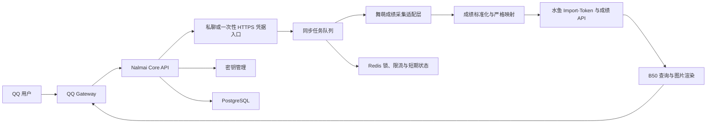

# Nalmai 项目实现报告

> 文档版本：1.1  
> 编制日期：2026-09-17  
> 项目名称：Nalmai  
> 文档性质：立项、架构、研发与验收基线

## 1. 执行摘要

Nalmai 是一个面向 QQ 群用户的舞萌 DX 成绩同步机器人。首期用户界面收敛为三个动作：`/bind` 绑定水鱼、提交 `SGWCMAID...` 同步成绩、`/b50` 返回 B50 图片。用户从项目方当前提供的微信入口“舞萌I中二”取得玩家二维码识别文本，Nalmai 读取成绩、转换为水鱼成绩结构、使用绑定账号的 `Import-Token` 写入水鱼，再查询并渲染 B50。微信入口的正式展示名称在上线文案定稿前由项目方按实际页面确认。

项目可以实现，但必须在交互上落实三项约束：

1. `Import-Token` 是水鱼用户级读写凭据，`SGWCMAID...` 是本次舞萌账号会话凭据，两者均不得进入普通日志、监控标签或群聊长期记录。
2. 用户提出的命令形式保留为 `@Nalmai /bind <QQ号码> <Import-Token>`，参数之间统一使用空格，不使用 `+` 作为分隔符。群聊中只接受 `/bind` 命令并引导到私聊或一次性 HTTPS 页面；只有在实际 QQ 权限验证和项目方明确接受风险后，才开放群内携带凭据的兼容模式。
3. QQ 开放平台事件中的发送者标识不等同于用户填写的数字 QQ 号。Nalmai 以真实事件中的稳定发送者标识作为本地绑定主键；用户填写的 QQ 号只作为业务查询信息，不用于证明发送者身份。

水鱼没有独立的“刷新 B50”写接口。Nalmai 上传成绩后，由水鱼 `/query/player` 根据已保存成绩返回最新 B50。因此项目中的“更新 B50”定义为“上传成绩成功，并验证水鱼 B50 查询结果已反映本次写入”。

## 2. 项目目标与范围

### 2.1 建设目标

- 提供 QQ 群内可发现、可操作的成绩同步入口。
- 使用用户本人提供的有效二维码识别文本读取本人成绩。
- 使用用户本人提供的水鱼 `Import-Token` 完成首期绑定，不收集水鱼账号密码。
- 将完整、准确的成绩字段写入水鱼查分器。
- 上传后获取最新 B50，并返回同步摘要或 B50 图片。
- 对二维码凭据、`Import-Token`、后续 OAuth 凭据和用户标识实施最小化保存与脱敏审计。
- 将 QQ 接入、成绩采集、水鱼写入、B50 展示拆成可独立替换的模块。

### 2.2 首期不实现的内容

- 不绕过 QQ 开放平台权限读取未授权的群消息。
- 不保存或传播舞萌原始用户 ID、二维码原文和水鱼密码；`Import-Token` 仅以加密密文保存。
- 不自行推断华立接口的 URL、Header、JSON 路径或加密规则。
- 不提供批量抓取他人成绩、撞库、代登录或账号共享能力。
- 不把水鱼旧 `Developer-Token` 作为正式依赖；它与用户提供的 `Import-Token` 不是同一种凭据。
- 不在没有许可证授权的情况下复制第三方插件代码。

## 3. 用户流程

首期命令契约如下：

| 用户输入 | 推荐会话 | Bot 输出 |
|---|---|---|
| `@Nalmai /bind` | QQ 群 | 私聊或一次性 HTTPS 绑定入口 |
| `@Nalmai /bind <QQ号码> <Import-Token>` | 私聊或安全页面 | 绑定成功/失败；只显示遮挡后的账号信息 |
| `@Nalmai SGWCMAID...` | 私聊或安全页面 | 上传成功/失败、任务编号和非敏感统计 |
| `@Nalmai /b50` | QQ 群或私聊 | 当前绑定账号的 B50 图片 |

解析器只识别表中定义的命令与参数位置，不对键名、别名或消息结构进行推测。

### 3.1 首次绑定：`/bind`

1. 用户在群内发送 `@Nalmai /bind`，Bot 返回私聊入口或一次性 HTTPS 绑定页。
2. 用户在私密入口提交 `@Nalmai /bind <QQ号码> <Import-Token>`；参数之间仅用空格分隔。
3. Nalmai 从真实 QQ 事件中取得稳定发送者标识。准确字段名必须由实际脱敏事件 JSON 确认。
4. Nalmai 使用请求头 `Import-Token: <用户提交值>` 调用 `GET /player/records` 验证凭据。
5. 验证成功后，从该接口的真实响应读取准确 `username`，建立“平台发送者标识—用户填写 QQ 号—水鱼 username—加密 Import-Token”的本地映射。
6. Bot 只回复遮挡后的 QQ 号、水鱼用户名和“绑定成功”；不得回显完整 Token。

如果项目方坚持在群聊中直接执行完整 `/bind`，必须先验证 Bot 是否有权撤回成员消息，并明确接受客户端通知、其他 Bot、审计系统和群成员可能已经复制凭据的风险。撤回不能等同于未泄露。

### 3.2 单次成绩同步：提交 `SGWCMAID...`

1. 用户在私聊发送 `@Nalmai SGWCMAID...`；群聊兼容模式只有在风险条件满足后启用。
2. Nalmai 以发送者平台标识查询绑定；未绑定时返回 `/bind` 引导。
3. Nalmai 严格确认正文参数以 `SGWCMAID` 开头，将原文置于任务内存，不写数据库、普通日志或队列死信。
4. 成绩采集适配层解析本次凭据并获取上游实际返回的基础成绩。
   当前 SGWC 路线不返回新的 FC、FS 和 PC 次数，不得将其描述为
   完整成绩。
5. 在可从锁定依赖或真实脱敏响应取得准确玩家标识后，Nalmai 校验本次舞萌玩家与已绑定水鱼账号的对应关系；当前证据不足时不得静默上传，应展示脱敏玩家信息并要求用户确认。
6. 转换层使用水鱼 `/music_data` 的精确曲名和类型构造成绩数组。
7. Nalmai 解密当前用户的 `Import-Token`，通过准确的 `Import-Token` 请求头调用水鱼成绩写入端点。
8. 成功条件为水鱼返回成功且提交条数与已处理条数通过一致性检查；随后清除内存中的二维码原文。
9. Bot 回复“上传成功”或“上传失败”，并给出任务编号、成功数量、跳过数量和非敏感错误原因；不得回显凭据。

### 3.3 B50 图片：`/b50`

1. 用户发送 `@Nalmai /b50`。
2. Nalmai 以发送者平台标识查找绑定，并取得绑定验证阶段保存的准确水鱼 `username`。
3. Nalmai 调用 `POST /query/player`，请求体使用该 `username` 和非空 `b50`。
4. B50 渲染模块将响应数据转换为图片并发送到当前会话。
5. 若公开查询因隐私设置返回 403，Nalmai 使用绑定的 `Import-Token` 读取完整成绩，并在锁定且通过回归测试的 B50 算法上本地渲染；该能力未验收前应明确回复“隐私设置阻止公开 B50 查询”。

### 3.4 失败处理

- 未绑定水鱼：返回 `/bind` 指令，不进入成绩采集或 B50 渲染。
- `Import-Token` 无效或已轮换：绑定或上传失败，要求用户重新执行 `/bind`。
- 提交内容不是完整 `SGWCMAID...`：拒绝任务，不进行前缀以外的格式猜测。
- 二维码过期或上游拒绝：删除本次内存凭据，要求用户重新生成二维码。
- 水鱼返回鉴权错误：删除内存明文，保留加密绑定记录并提示重新绑定；不得自动尝试其他鉴权方式。
- 玩家对应关系无法确认：停止上传并要求用户确认，不进行静默绑定或错账号写入。
- 水鱼限流：保留任务状态，不重复使用已经失效的一次性凭据。
- 曲目无法精确映射：整条记录不上传，并记录不含凭据的结构化错误；禁止模糊匹配曲名。
- 上传成功但 B50 查询失败：任务标记为“上传成功、验证失败”，不得把验证失败描述成上传失败。

## 4. 总体架构



### 4.1 推荐部署形态

| 服务 | 推荐技术 | 职责 |
|---|---|---|
| `nalmai-app` | Python 3.11、NoneBot2、`nonebot-adapter-qq` | QQ 鉴权、事件接收、消息回复、命令编排 |
| `nalmai-core` | Python 3.11、FastAPI、httpx | 凭据绑定、提交页、业务编排、水鱼 API、B50 渲染；可与 `nalmai-app` 同进程部署 |
| `sync-worker` | Python 3.11、异步任务执行器 | 成绩采集、转换、上传、结果验证 |
| `postgres` | PostgreSQL | 用户绑定、任务与审计状态 |
| `redis` | Redis | 一次性 nonce、单用户锁、幂等键、限流状态 |
| `reverse-proxy` | Caddy 或 Nginx | HTTPS、请求大小限制、安全响应头 |

首期采用单一 Python 运行时，降低跨语言部署和类型转换成本。规模扩大后，`nalmai-app` 与 `sync-worker` 可以拆分；拆分时使用内部签名请求通信。生产环境不得把 Core API、PostgreSQL 或 Redis 直接暴露到公网。

### 4.2 QQ 接入策略

正式版使用 QQ 开放平台，并以 `NoneBot2 + nonebot-adapter-qq` 作为主框架。`nonebot-adapter-qq` 支持 WebSocket 与 Webhook，2026 年发布的 1.7.1 已加入群聊全量消息事件及回复支持，1.7.2 继续修复群聊事件和回复处理。实际采用哪一种传输、能否接收无 `@` 的普通群消息，必须以 q.qq.com 控制台对 Nalmai 应用实际开放的事件和真实事件 JSON 为准。适配器具备相应事件类型不等于 Nalmai 账号已经获得该事件权限。

基线交互规定为：

- 群内：`@Nalmai /bind` 只返回私密入口；`@Nalmai /b50` 直接返回图片；另提供 `/status` 和 `/unbind`。
- 私聊或一次性 HTTPS 页面：提交完整 `/bind <QQ号码> <Import-Token>` 和 `SGWCMAID...`。
- 群聊凭据兼容模式：默认关闭，只有撤回能力和风险接受均已确认时启用；入口中间件必须在任何日志记录前完成凭据遮挡。
- 无 `@` 自动识别：只有控制台明确授权普通群消息事件且在目标群实测通过后启用。
- 任何外部事件字段的读取均以真实事件 JSON 和所选 SDK 类型定义为准，不在设计阶段猜测字段名。

## 5. 水鱼绑定与成绩接口

### 5.1 三种凭据的边界

| 凭据 | 性质 | Nalmai 采用方式 |
|---|---|---|
| `Import-Token` | 用户在水鱼个人资料中生成的个人凭据；凭据本身确定水鱼账号 | 首期 `/bind` 使用；加密保存，可用于读取和更新该用户成绩 |
| `Developer-Token` | 旧应用级凭据，可以按 `qq` 或 `username` 指定查询对象 | 已废弃且停止签发；相关旧端点将在 2026-10-01 00:00（UTC+8）停止服务；Nalmai 不使用 |
| OAuth Bearer | 当前第三方应用授权方案，按用户授权并受 scope 控制 | 作为后续迁移方向；写入需要 `prober.records.write` 且需人工审核 |

用户所说的“成绩导入 token”在 Nalmai 文档和界面中统一写为准确名称 `Import-Token`，不得与 `Developer-Token`、OAuth access token 混称。

### 5.2 `/bind` 验证

水鱼文档规定 `Import-Token` 通过准确请求头传递：

```text
Import-Token: <用户提交的 Import-Token>
```

Nalmai 使用以下接口进行绑定验证：

```text
GET https://www.diving-fish.com/api/maimaidxprober/player/records
Import-Token: <用户提交的 Import-Token>
```

成功响应中包含准确 `username`、`nickname`、`rating` 和 `records`。Nalmai 保存响应中的 `username` 作为水鱼账号查询键，不从用户填写的 QQ 号推断水鱼用户名。若接口返回 `400` 且响应说明导入 token 有误，则绑定失败；对外回复不回显 Token。

### 5.3 成绩上传

成绩写入端点：

```text
POST https://www.diving-fish.com/api/maimaidxprober/player/update_records
Import-Token: <解密后的用户 Import-Token>
Content-Type: application/json
```

请求体为 JSON 数组。每条成绩使用官方明确列出的字段：

| 字段 | 规则 |
|---|---|
| `achievements` | 数字，超过 101.0000 时由服务端按上限处理 |
| `dxScore` | 数字，提交前由 Nalmai 校验为非负整数 |
| `fc` | 仅传官方允许值或空值 |
| `fs` | 仅传官方允许值或空值 |
| `level_index` | 整数，必须对应实际存在的谱面难度 |
| `title` | 必须与水鱼 `/music_data` 的标题完全一致 |
| `type` | 必须为实际存在的 `SD` 或 `DX` 谱面类型 |

转换器不得根据大小写、相似度、别名或编号关系猜测 `title`。无法精确映射时，将该记录列入错误报告并停止将其写入上传数组。

上传成功不能只按 HTTP 2xx 判断。Nalmai 同时核对响应中的 `message`，并记录 `updates`、`creates`；准确响应结构在锁定接口版本的集成测试中确认。服务端可能跳过无法定位的谱面，因此还要将上传数组长度与处理结果进行一致性校验。

### 5.4 B50 查询与渲染

公开 B50 查询端点：

```text
POST https://www.diving-fish.com/api/maimaidxprober/query/player
Content-Type: application/json
```

请求体包含准确的 `username` 或 `qq`，并包含非空 `b50` 参数，例如：

```json
{
  "username": "由 /player/records 验证响应返回的准确用户名",
  "b50": "1"
}
```

`/query/player` 返回 B50 数据，不直接返回图片。Nalmai 的 `B50Renderer` 负责版式、字体、曲绘缓存、缺图占位和图片发送。若用户隐私设置使公开查询返回 403，Nalmai 尊重该设置；由于首期已经持有该用户的 `Import-Token`，可以从 `/player/records` 读取完整成绩并本地计算，但只有在 B35/B15 划分、版本识别和 Rating 算法通过锁定样本回归测试后才能启用此回退路线。

### 5.5 OAuth 迁移接口

首期采用 `Import-Token` 是为了匹配用户确认的三步操作。内部 `DivingFishCredentialProvider` 必须允许未来迁移到 OAuth，而不改动成绩转换和渲染模块。迁移时在水鱼开发者控制台登记机密客户端，申请 `openid profile prober.records.read prober.records.write`；`client_secret` 只保存在服务端密钥系统中。

## 6. 舞萌成绩采集适配层

### 6.1 技术边界

`SGWCMAID...` 到官方成绩的采集不属于水鱼公开 API。水鱼仓库明确说明，查分器本身不能直接从华立官方获取数据。Nalmai 必须将该部分封装为独立适配层，以便上游协议变化时替换，而不影响 QQ、水鱼凭据适配层和任务系统。

### 6.2 可替换的验证实现

在项目方书面接受闭源 wheel 风险并固定运行平台后，验证环境可以使用 `maimai.py` 的 `MaimaiClient` 与 `ArcadeProvider`：

```python
from maimai_py import ArcadeProvider, MaimaiClient

maimai = MaimaiClient()
arcade = ArcadeProvider()

async def read_arcade_scores(qr_text: str):
    text = qr_text.strip()
    if not text.startswith("SGWCMAID"):
        raise ValueError("不是完整的 SGWCMAID 二维码识别文本")

    player = await maimai.qrcode(text, provider=arcade)
    return await maimai.scores(player, provider=arcade)
```

上述代码只采用项目公开文档中已经明确的方法与参数。任何更底层请求都必须从选定版本的源码、类型定义、测试或脱敏抓包中获取准确表述。

### 6.3 依赖限制

- `ArcadeProvider` 依赖编译后的 `maimai-ffi`。
- `maimai.py` 文档说明这部分实现不是完整公开源码。
- 依赖必须锁定版本、保存包哈希，并在升级前运行真实环境兼容测试。
- 成绩字段必须实测 FC、FC+、AP、AP+、FS、FS+、FSD、FSD+、SYNC 等状态是否完整；缺失时明确告知用户，不得根据达成率补全。
- 不在报告中写入未经核验的华立请求路径、请求头、密钥、加密方法和返回 JSON 路径。

### 6.4 Windows 微信 OAuth 全开源页面路线

2026-09-23 完成真实授权页面的一次性脱敏采集。采集器通过临时
Clash 规则只将 `tgk-wcaime.wahlap.com` 的 HTTP 80 端口回调送到本机，
不安装代理根证书，不解密 HTTPS；采集结束后恢复原 Clash 配置。
输出包只包含脱敏 HTML 和清单，不包含 Cookie、OAuth 授权参数或原始网页。

实测页面已确认如下字段：

- 成绩列表页：谱面难度、等级、曲名、达成率、DX 分、FC、FS、评级、SD/DX 类型。
- 曲目详情页：以上字段以及单谱面游戏次数（PC）和 DX 星数。
- 实测脱敏包含 5 个成绩列表页和 5 个详情页；解析器从列表页
  读取 1274 条已游玩成绩，从详情页读取 8 个谱面详情。

该路线与 `SGWCMAID...` 路线使用不同授权会话，凭据不能互换。
1.5 版本已建立“QQ 私聊 `/wechat`——本机微信回调——同一 QQ 用户上传”
的一次性关联，但范围限于机器人、Windows 微信和 Clash Verge 均在同一台
电脑的单用户环境。只发送 SGWC 仍不会触发该路线。

## 7. GitHub 开源设施评估

以下状态核验日期为 2026-09-17。正式落库时应记录使用的 commit SHA 和许可证文本。

### 7.1 可直接依赖

| 项目 | 用途 | 许可证/状态 | Nalmai 采用方式 |
|---|---|---|---|
| [`nonebot/nonebot2`](https://github.com/nonebot/nonebot2) | Python 异步 Bot 框架 | MIT；持续维护 | Nalmai 正式应用框架 |
| [`nonebot/adapter-qq`](https://github.com/nonebot/adapter-qq) | QQ 开放平台适配器 | MIT；2026-08-09 发布 1.7.2；持续维护 | Nalmai 正式 QQ 接入；锁定验收版本 |
| [`Diving-Fish/maimaidx-prober`](https://github.com/Diving-Fish/maimaidx-prober) | 水鱼数据结构、API 服务端参考 | MIT；公开源码和正式文档 | 用于核验字段、错误行为与测试数据，不自行部署来规避官方服务规则 |
| [`TrueRou/maimai.py`](https://github.com/TrueRou/maimai.py) | 多数据源标准模型与成绩调用 | GitHub 仓库显示 Apache-2.0；持续维护 | 用于成绩模型、`ArcadeProvider` 抽象与本地 B50 处理；记录选定 commit 的 LICENSE |
| [`Shio796/maimai-b50-image-generator`](https://github.com/Shio796/maimai-b50-image-generator) | 本地 B50 图片生成 | MIT | 仅在数据模型验收通过后作为图片渲染参考或依赖 |

### 7.2 可学习吸收，但不直接复制

| 项目 | 可学习内容 | 限制 |
|---|---|---|
| [`tencent-connect/qqbot-nodejs`](https://github.com/tencent-connect/qqbot-nodejs) | QQ 官方协议、Webhook、消息中间件和媒体上传设计 | MIT；腾讯官方；要求 Node.js 20；公开历史较短。Nalmai 已选 Python 主线，不同时引入第二套 QQ 运行时 |
| [`tencent-connect/botpy`](https://github.com/tencent-connect/botpy) | 旧版官方 Python 事件模型和示例 | MIT；维护时间早于当前 `nonebot-adapter-qq`，不作为主 SDK |
| [`tencent-connect/botgo`](https://github.com/tencent-connect/botgo) | QQ 官方旧链路与迁移背景 | Apache-2.0；README 已说明旧 WebSocket 事件链路不再维护，不作为主 SDK |
| [`nonebot/adapter-onebot`](https://github.com/nonebot/adapter-onebot) | OneBot 事件、消息和 API 适配 | MIT；仅在隔离的 NapCat 试验通道需要，正式 QQ 开放平台路线不引入 |
| [`XiaoLan9999/astrbot_plugin_maimai_updater`](https://github.com/XiaoLan9999/astrbot_plugin_maimai_updater) | SGID 命令流程、Import-Token 绑定、敏感消息撤回、字段完整性测试、跨平台兼容测试 | 仓库根目录未发现明确许可证文件；不复制代码。Nalmai 只学习已公开的交互和测试场景，并自行实现 Import-Token 与后续 OAuth 的可替换凭据层 |
| `AWMC-TEAM/maimaiDX-QueryBot` | 搜索缓存中可见 B50 命令、数据源切换、缓存、图片渲染和账号状态设计 | 审查时精确 GitHub 地址返回 404，当前源码、许可证和版本均无法核验；不依赖、不复制，项目方提供有效精确地址后重新评审 |
| [`AstrBotDevs/AstrBot`](https://github.com/AstrBotDevs/AstrBot) | 插件生命周期、管理后台、IM 接入和配置设计 | AGPL-3.0；若把修改后的 AstrBot 作为网络服务运行，应履行相应源代码提供义务。Nalmai 默认不以其为核心框架 |

### 7.3 仅用于隔离测试

| 项目 | 用途 | 限制 |
|---|---|---|
| [`NapNeko/NapCatQQ`](https://github.com/NapNeko/NapCatQQ) | 普通 QQ 账号的 OneBot 11 协议端、消息撤回和群消息测试 | 非 QQ 官方机器人方案；仓库为混合许可并包含额外使用限制；与 QQNT 版本存在耦合。不得作为默认生产入口 |
| [`maimai-ffi`](https://pypi.org/project/maimai-ffi/) | `ArcadeProvider` 使用的编译模块 | PyPI 只分发 wheel，源码仓库为 private，公开材料无法确认完整许可证与内部实现；不得默认成为生产核心。确需使用时须书面接受供应链风险、保存 wheel 哈希、限制运行权限并保持可替换 |

### 7.4 开源吸收原则

1. 优先调用稳定公开 API，而不是复制第三方内部实现。
2. 每项依赖在 `THIRD_PARTY_NOTICES.md` 中记录仓库、commit SHA、许可证和修改情况。
3. 生成 SBOM；闭源 wheel 除版本外还要记录文件名、Python ABI、目标平台和 SHA-256。
4. 未发现许可证的仓库只学习公开行为、测试场景和架构思路，不复制代码或资源。
5. 对 AGPL、GPL、混合许可和附加限制进行单独评审。
6. 不复制第三方字体、曲绘、游戏资源或品牌素材；B50 图所需资源必须单独确认来源和授权。

## 8. Nalmai 内部模块设计

以下名称是 Nalmai 新定义的内部接口，不对应任何外部服务字段。

### 8.1 `QQGateway`

- 接收并验证 QQ 平台事件。
- 规范化为内部 `InboundCommand`。
- 只向 Core API 发送命令类型、平台用户标识、会话标识和消息引用。
- 对原始事件日志实施字段白名单。
- 发送文本、链接、图片和任务状态。

### 8.2 `BindingService`

- 接收用户填写的 QQ 号和 `Import-Token`，但以 QQ 事件中的稳定发送者标识作为绑定主键。
- 使用 `GET /player/records` 验证 `Import-Token`，从响应读取准确水鱼 `username`。
- 通过独立密钥管理服务加密凭据；数据库只接收密文、密钥版本和遮挡显示值。
- 提供重新绑定、`/unbind` 和本地数据删除。
- 通过 `DivingFishCredentialProvider` 预留 OAuth 迁移能力。

### 8.3 `SubmissionService`

- 创建 256 位随机 nonce。
- nonce 有效期定义为 5 分钟，只能成功消费一次。
- 页面只接受一个文本字段，限制请求大小。
- 提交后立即把原文交给任务队列，响应页面不回显凭据。
- Web 访问日志不得包含请求体。
- 私聊消息入口在框架日志中间件之前遮挡 `Import-Token` 和 `SGWCMAID...`。

### 8.4 `ArcadeScoreProvider`

- 接收一次性二维码识别文本。
- 调用固定版本成绩依赖。
- 返回 Nalmai 内部 `NormalizedScore` 列表。
- 禁止向日志、错误跟踪和数据库发送原始二维码或解密后的用户 ID。

### 8.5 `DivingFishClient`

- 使用 `Import-Token` 验证绑定、写入成绩和读取完整成绩。
- 使用绑定验证响应中的准确 `username` 调用公开 B50 查询。
- 将鉴权封装在 `DivingFishCredentialProvider` 后，允许后续替换为 OAuth Bearer。
- 对 400、401、403、429、5xx 分别处理。
- 鉴权失败时标记绑定需要更新；429 时遵守服务端限制，不进行无界重试。

### 8.6 `B50Renderer`

- 接收 `/query/player` 的 B50 数据并生成图片。
- 使用固定字体和已确认授权的素材；缺少曲绘时使用项目自有占位图。
- 渲染结果可以短期缓存，但缓存键不得包含 `Import-Token` 或二维码凭据。
- 公开查询受隐私设置阻止时，只在本地 B50 算法已通过回归测试后使用完整成绩回退。

### 8.7 `SyncOrchestrator`

任务状态机由 Nalmai 定义为：

```text
CREATED
  -> CREDENTIAL_ACCEPTED
  -> FETCHING_SCORES
  -> NORMALIZING
  -> UPLOADING
  -> VERIFYING_B50
  -> SUCCEEDED

任一步骤可进入 FAILED；上传成功但验证失败进入 UPLOADED_UNVERIFIED。
```

每个用户同一时间只允许一个活动任务。重复提交使用二维码内容的 HMAC 摘要做短期幂等判断，HMAC 密钥独立保存在服务端密钥系统中。

## 9. 数据设计

### 9.1 `users`

| 字段 | 说明 |
|---|---|
| `id` | Nalmai 内部 UUID |
| `platform` | 固定值 `qq_official` 或测试环境值 |
| `platform_user_id` | 从已核验 QQ 事件取得的稳定用户标识 |
| `claimed_qq` | 用户在 `/bind` 中填写的数字 QQ；仅作业务信息，不作为平台身份凭证 |
| `divingfish_username` | 由 `/player/records` 验证响应返回的准确用户名 |
| `import_token_ciphertext` | 使用部署密钥加密后的 `Import-Token` 密文 |
| `credential_key_version` | 加密密钥版本，用于轮换和重新加密 |
| `credential_mask` | 仅用于状态页显示的遮挡值，不可用于鉴权 |
| `binding_status` | `UNBOUND`、`BOUND`、`ROTATION_REQUIRED`、`REVOKED` |
| `bound_at` / `credential_rotated_at` | 绑定和凭据轮换时间 |
| `created_at` / `updated_at` | UTC 时间 |

### 9.2 `sync_jobs`

| 字段 | 说明 |
|---|---|
| `id` | 任务 UUID，也是用户回执编号 |
| `user_id` | 关联 `users.id` |
| `status` | 状态机值 |
| `credential_digest` | 短期 HMAC 摘要；不保存原文 |
| `score_count` | 成功读取的成绩数量 |
| `uploaded_count` | 实际提交的成绩数量 |
| `skipped_count` | 因无法精确映射而跳过的数量 |
| `rating_before` / `rating_after` | 查询得到时保存；未得到则为空 |
| `error_code` | Nalmai 内部稳定错误码 |
| `created_at` / `finished_at` | UTC 时间 |

`credential_digest` 在幂等窗口结束后清除。任何表都不得包含 `SGWCMAID` 原文、QQ AppSecret、`Import-Token` 明文、水鱼 client_secret 或 OAuth access token。上述列名是 Nalmai 在本报告中定义的内部 schema，实施时一旦建立迁移文件，代码、测试和文档必须严格使用迁移文件中的名称。

## 10. 安全与隐私设计

### 10.1 凭据保护

- QQ AppSecret、`Import-Token` 加密主密钥、OAuth client_secret 和 HMAC 密钥使用部署平台 Secret 管理。
- `Import-Token` 以带认证加密的密文持久化，解密只发生在调用水鱼接口前的最短路径；明文不得写入 Redis。
- OAuth access token 只存在于内存或 Redis 加密缓存，按实际过期时间删除。
- 关闭 Web 服务器请求体日志和异常跟踪中的局部变量捕获。
- 错误消息只返回任务编号和稳定错误码。
- 数据库备份加密，并设置明确保留周期。

### 10.2 提交页保护

- 全站 HTTPS。
- nonce 与 QQ 用户、任务、会话绑定。
- `Cache-Control: no-store`。
- Content Security Policy 只允许本站资源。
- 禁止第三方统计脚本和外部字体。
- 提交成功后使用 `POST/Redirect/GET`，结果页不包含凭据。
- 表单不得将输入写入浏览器本地存储。

### 10.3 群聊保护

- 正式流程不要求在群里发送 `Import-Token` 或 `SGWCMAID...`；群内 `/bind` 只返回私密入口。
- 若启用群聊凭据兼容模式，必须在真实 QQ 权限验证允许时立即尝试撤回，同时提示用户主动轮换已公开的 `Import-Token`。撤回不能消除通知、缓存、其他 Bot 和旁观者已经取得内容的风险。
- Bot 回复不得引用原始凭据消息正文。
- 群内结果仅包含玩家展示名、同步数量、Rating/B50 摘要和任务编号。

### 10.4 用户权利

- `@Nalmai /unbind`：删除加密 `Import-Token` 和本地绑定关系。
- `@Nalmai 删除我的数据`：删除本地用户映射、任务明细和缓存。
- `@Nalmai /status`：展示绑定状态、最近成功时间和最近任务编号，不展示凭据。
- 用户在水鱼侧重新生成 `Import-Token` 后，旧凭据失效；Nalmai 将鉴权失败转为 `ROTATION_REQUIRED`。

## 11. 测试计划

### 11.1 单元测试

- `/bind` 只接受严格定义的参数数量，QQ 号与 `Import-Token` 之间使用空格分隔。
- `Import-Token` 加密、解密、密钥轮换和遮挡显示均不泄露明文。
- 一次性 nonce 只能消费一次，过期后拒绝。
- 非 `SGWCMAID` 输入被拒绝。
- `/music_data` 精确标题和类型映射。
- 无法映射的成绩不进入上传数组。
- FC/FS 枚举不被推断或补全。
- 华立列表页按实测图标顺序解析 FC、FS 与评级。
- 华立详情页按实测表格标签解析 PC，并读取 DX 星数。
- 未游玩或缺少必要字段的卡片不进入上传数组。
- 401、403、429 和 5xx 映射到稳定内部错误码。
- 日志过滤器删除二维码、`Import-Token`、Secret 和 Authorization 值。

### 11.2 集成测试

- QQ 沙箱真实事件到命令解析。
- 使用 `Import-Token` 调用 `/player/records` 的绑定验证流程。
- `Import-Token` 正确、错误、重新生成后失效三种状态。
- 使用水鱼 `/player/test_data` 验证数据模型。
- `/player/update_records` 的成功、部分跳过、鉴权失败和限流状态。
- 成绩采集依赖在 Windows x86-64 与 Linux x86-64 上的兼容性。
- 上传后 `/b50` 查询、渲染和图片发送验证。
- 公开 B50 查询返回 403 时的明确回执与本地渲染回退验证。
- 同一用户并发提交只执行一个任务。
- 两名用户并发绑定和更新时不发生凭据、任务或结果串用。
- 服务重启时任务状态恢复，二维码原文不恢复。

### 11.3 安全测试

- 提交页 nonce 猜测、重放、跨用户使用。
- 日志、APM、反向代理和数据库中搜索敏感前缀。
- 群聊误发 `Import-Token` 与 `SGWCMAID...` 后不回显、不引用，并按已验证权限执行处置。
- 超长消息、异常 Unicode、换行和前后空白。
- 伪造 QQ Gateway 到 Core API 的内部请求。
- SSRF、开放重定向、错误页凭据回显。
- 密钥轮换和授权撤销。

### 11.4 上线验收用例

1. 新用户通过私聊或一次性页面完成 `Import-Token` 绑定，系统从 `/player/records` 取得准确水鱼用户名。
2. 用户通过私聊或一次性页面提交当前二维码识别文本。
3. Nalmai 成功读取成绩且不在日志中出现原文。
4. 水鱼 `/player/update_records` 返回成功。
5. `/b50` 查询结果反映上传后的成绩，图片成功渲染并发送。
6. 群内只显示脱敏结果。
7. 用户执行删除后，本地找不到其绑定和任务详情。

## 12. 可观测性与运维

### 12.1 指标

- `nalmai_sync_started_total`
- `nalmai_sync_succeeded_total`
- `nalmai_sync_failed_total{stage,error_code}`
- `nalmai_sync_duration_seconds{stage}`
- `nalmai_score_count`
- `nalmai_divingfish_http_requests_total{status}`
- `nalmai_qq_events_total{type}`
- `nalmai_active_jobs`

标签中禁止出现 QQ 标识、用户名、二维码摘要和任务原始输入。

### 12.2 日志

结构化日志只允许：时间、服务名、任务 UUID、阶段、内部错误码、耗时和非敏感计数。生产环境禁止 DEBUG 级别记录第三方 HTTP 请求体。

### 12.3 告警

- 连续 `Import-Token` 绑定或鉴权失败；启用 OAuth 后同时监控 OAuth 失败。
- 水鱼 429 或 5xx 比例超过运维阈值。
- 舞萌采集适配层失败率突增。
- 队列积压。
- 同一依赖升级后字段完整性测试失败。

阈值应根据上线后的真实基线配置，不在未取得流量数据前猜测。

## 13. 研发阶段

### 阶段 A：证据与接入准备

- 获取 q.qq.com 权限页和脱敏真实事件 JSON。
- 用专用测试账号生成 `Import-Token`，验证 `/player/records`、`/player/update_records` 与 `/query/player`。
- 确定成绩采集依赖的仓库、版本、包哈希和运行平台。
- 锁定 B50 渲染器、字体和素材授权。
- 建立第三方许可证清单。

### 阶段 B：安全闭环原型

- QQ 沙箱命令。
- 一次性提交页。
- `Import-Token` 加密绑定、重新绑定与解绑。
- 单用户串行队列。
- 成绩采集、转换、上传和文本回执。
- `/b50` 查询、渲染与图片发送。

### 阶段 C：功能完善

- B50 高级图片模板、缓存与缺图回退。
- 隐私模式下使用 `Import-Token` 读取与本地渲染。
- 解绑、数据删除、重试和运维后台。
- Windows/Linux 兼容矩阵。
- 根据应用登记和审批结果增加 OAuth，并提供从 `Import-Token` 迁移的用户流程。

### 阶段 D：生产上线

- 安全测试与许可证复核。
- 灰度群运行。
- 指标基线与告警。
- 依赖升级流程和回滚方案。

## 14. 风险登记

| 风险 | 影响 | 处理策略 |
|---|---|---|
| QQ 应用未获得普通群消息事件 | 无法实现裸文本自动识别 | 基线交互使用 `@Nalmai`；以真实控制台权限决定是否扩展 |
| `Import-Token` 或二维码凭据在群内泄露 | 水鱼成绩读写或舞萌账号访问风险 | 群内仅引导私密入口；入口先脱敏再记录日志；误发后提示轮换 Token |
| 用户填写的 QQ 号不属于发送者 | 错误账号映射 | 以平台发送者标识作为本地身份；QQ 号只作业务信息；水鱼账号由 Token 验证响应确定 |
| 二维码玩家与水鱼账号不一致 | 成绩被写入错误账号 | 使用经源码或实测确认的准确标识核对；无法核对时要求用户确认并停止自动上传 |
| 成绩采集协议变化 | 同步中断或字段缺失 | 独立适配层、锁版本、兼容测试、快速回滚 |
| `maimai-ffi` 闭源 wheel | 许可证、内部行为、漏洞修复与审计能力受限 | 默认不进入生产；确需使用时书面批准、服务隔离、最小权限、保存 wheel 哈希并保留替换接口 |
| `Import-Token` 被重新生成或撤销 | 上传与完整成绩读取失败 | 标记 `ROTATION_REQUIRED`，要求用户重新执行 `/bind` |
| 曲名映射错误 | 成绩写入错误歌曲 | 只接受 `/music_data` 精确匹配；不做格式或大小写猜测 |
| 第三方仓库许可证不明确 | 版权风险 | 仅学习行为和测试思路，不复制代码或资源 |
| 水鱼或 QQ 限流 | 任务延迟或失败 | 队列、退避、明确回执；禁止无限重试 |
| 游戏素材授权不清 | B50 图片发布风险 | 单独核验字体、曲绘、模板和品牌素材授权 |

## 15. 当前硬性信息缺口

进入可运行工程开发前，需要项目方提供或确认：

1. q.qq.com 中 Nalmai 机器人实际开通的事件与权限页面截图。
2. 一条脱敏后的真实群消息事件 JSON；保留字段名和结构，只替换值。
3. 是否接受正式版使用私聊或一次性 HTTPS 页面提交 `Import-Token` 与二维码凭据；若坚持群聊直传，需要明确接受泄露风险。
4. 一枚专用测试账号的 `Import-Token` 由项目方在测试环境自行配置，不通过聊天发送。
5. 明确选择的成绩采集仓库、固定版本和运行平台；若使用 `maimai-ffi`，还需书面确认接受闭源 wheel 风险及目标 OS、CPU、Python ABI。
6. 指定 B50 图片渲染器仓库与固定版本，并确认字体、曲绘和模板素材授权。
7. 预计部署系统、CPU 架构和并发规模。

在这些信息到位前，可以完成仓库骨架、数据库、Import-Token 客户端、提交页和测试框架，但不能声称 QQ 无 `@` 自动识别、完整成绩采集、玩家对应关系校验和端到端生产链路已经验证。

## 16. 验收标准

Nalmai 首期上线必须同时满足：

- 使用 QQ 开放平台真实沙箱事件完成命令闭环。
- 用户不向群里公开发送二维码凭据也能完成同步。
- 首期只使用用户本人的 `Import-Token`，不使用用户名、密码或旧 `Developer-Token`；后续 OAuth 迁移不破坏业务模块。
- 上传成绩字段与官方文档完全一致。
- 不模糊匹配曲名，不推断 FC/FS。
- 二维码原文、`Import-Token` 明文、OAuth access token 和 secret 不进入持久化存储与普通日志。
- `/bind`、成绩上传、`/b50` 三条用户链路均通过真实 QQ 事件完成验收。
- `/b50` 输出可打开的图片；缺图、隐私限制和渲染失败均有明确回执。
- 上传结果和 B50 验证结果分别记录。
- 解绑、凭据轮换和本地数据删除可用。
- 第三方依赖、commit SHA、许可证和素材授权形成清单。
- 自动测试覆盖绑定、上传、失败、限流、重放和隐私场景。

## 17. 主要参考资料

### 官方与一手文档

- [水鱼 OAuth 快速开始](https://maimai.diving-fish.com/manual/docs/developer/oauth-quickstart/)
- [水鱼 OAuth 接口文档](https://maimai.diving-fish.com/manual/docs/developer/oauth-api-document/)
- [水鱼查分器 API 文档](https://maimai.diving-fish.com/manual/docs/developer/zh-api-document/)
- [Diving-Fish/maimaidx-prober](https://github.com/Diving-Fish/maimaidx-prober)
- [QQ 官方 Node SDK](https://github.com/tencent-connect/qqbot-nodejs)
- [QQ 官方 Python SDK](https://github.com/tencent-connect/botpy)
- [NoneBot QQ Adapter](https://github.com/nonebot/adapter-qq)
- [maimai.py 文档](https://maimai.turou.fun/)
- [ArcadeProvider 文档](https://maimai.turou.fun/providers/arcade.html)

### 工程与交互参考

- [NoneBot2](https://github.com/nonebot/nonebot2)
- [NoneBot OneBot Adapter](https://github.com/nonebot/adapter-onebot)
- [NapCatQQ](https://github.com/NapNeko/NapCatQQ)
- [AstrBot](https://github.com/AstrBotDevs/AstrBot)
- [AstrBot maimai 水鱼更新器](https://github.com/XiaoLan9999/astrbot_plugin_maimai_updater)
- [maimai B50 图片生成器](https://github.com/Shio796/maimai-b50-image-generator)

## 18. 版本 1.2 实测补充

2026-09-18 已使用真实 QQ 开放平台 WebSocket 事件完成以下取证与实现：

- 群聊 `GROUP_AT_MESSAGE_CREATE` 的用户字段为
  `author.member_openid`，群字段为 `group_openid`。
- 私聊 `C2C_MESSAGE_CREATE` 的用户字段为 `author.user_openid`。
- 同一测试用户的 `member_openid` 与 `user_openid` 在确定性 HMAC 脱敏后不相等，
  且两个事件中的 `union_openid` 均为空，因此不得直接推断跨场景身份一致。
- 身份关联采用私聊 `/pair` 生成、群聊 `/pair <8位配对码>` 消费的显式流程。
  配对码 5 分钟有效、只可使用一次，SQLite 仅保存配对码 HMAC 摘要。
- OpenID 原文不写数据库；内部身份键由 HMAC 派生。
- QQ 业务入口已接通 `/help`、`/bind`、`/pair`、`/status`、`/unbind`
  与 `/b50`，并使用 QQ 本地图片消息段返回 B50 PNG。
- 真实 QQ WebSocket 中，群聊与私聊 `/help` 均已验证能够正常返回。
- 当时自动测试共 52 项通过；另已完成源码与测试文件的 Python 字节码编译检查。
- `SGWCMAID...` 入口保持失败关闭：在明确许可的成绩采集实现和玩家对应校验到位前，
  `UnavailableArcadeScoreProvider` 会在上传水鱼前终止流程。

## 19. 版本 1.3 成绩热更新与 B50 模板

2026-09-23 完成以下增量实现；本节替代第 18 节中关于 SGWC 始终失败关闭的
旧状态说明：

- 新增可选 `MaimaiPyArcadeScoreProvider`，锁定 `maimai-py==1.5.2` 与
  `maimai-ffi==0.7.1`。管理员必须安装 `[arcade]` 依赖并显式设置
  `NALMAI_ARCADE_PROVIDER=maimai_py`，默认状态仍不访问机台服务。
- 有效 `SGWCMAID...` 只在当前私聊请求的内存中使用，不写数据库或普通日志。
- 华立 1.53+ 的当前上游实现只返回基础成绩，明确不返回新的 FC、FS、PC 次数。
  Nalmai 不猜测这些值：上传前读取水鱼已有成绩，缺失的 FC/FS 保留原值，
  PC 在 B50 中显示为 `—`。
- 同一 QQ 私聊身份同时完成水鱼绑定并主动提交一次性二维码，作为本次写入授权；
  当前接口没有可用字段证明华立账号与水鱼账号属于同一玩家，因此报告不声称
  已完成跨平台账号同一性核验。
- 新增五列 B35/B15 模板，显示曲名、封面、达成率、定数、单曲 RA、评级、
  FC/FS、DX 分与星数、歌曲 ID、歌曲版本、谱面难度和 SD/DX 类型。
- 曲目元数据来自水鱼 `/music_data`；封面来自水鱼文档规定的
  `/covers/{cover_id}.png`；均有缓存与缺失占位处理，不必爬取华立页面补齐。
- 当时自动测试 56 项通过，源码与测试文件通过 Python 字节码编译检查；
  `maimai-py` 与 `maimai-ffi` 已在独立 Windows/Python 3.12 AMD64 环境完成导入验证。

真实端到端验收仍需项目方在本机私聊机器人提交仍在有效期内的二维码身份码；
不得通过开发聊天、源码、日志或测试夹具传递该凭据。

## 20. 版本 1.4 微信页面取证与解析

2026-09-23 完成以下增量实现：

- 微信授权链接改为在采集器就绪后生成，避免授权回调早于监听器启动。
- 临时 Clash 规则仅处理精确域名与 HTTP 80 端口，并在成功、失败或
  中断后恢复原配置。
- 脱敏器保留成绩数值、等级和 PC 等业务字段，但屏蔽 Cookie、OAuth 参数、
  输入凭据和授权原文。
- 新增 `nalmai.wahlap_html` 解析器及真实页面结构回归测试。
- 主项目 59 项测试、微信采集器 7 项测试全部通过；两部分源码
  与测试文件均通过 Python 字节码编译检查。

本版本完成了全开源页面数据的采集和解析基础，但没有把 Windows 微信
会话伪装为 SGWC 会话。要将该路线面向多个 QQ 用户开放，下一版必须先
实现每位用户的一次性授权发起、回调关联、会话隔离、超时清理和审计记录。

## 21. 版本 1.5 本机单用户微信 OAuth 闭环

2026-09-24 完成本机单用户接入：

- QQ 私聊 `/wechat` 只允许已绑定用户创建授权任务。任务 5 分钟有效，
  同一私聊身份的新任务会替换未完成旧任务。
- QQ 进程同时启动只监听 `127.0.0.1` 的 FastAPI 回传服务。采集脚本
  使用 `.env` 的内部 API 令牌领取当前任务，不在命令行或日志输出该令牌。
- 任务领取后生成独立回传令牌，SQLite 只保存 HMAC-SHA256 摘要；
  原始回传令牌、OAuth 参数与 Cookie 不落盘。
- 采集器读取五个难度列表并向已绑定水鱼账号上传解析后成绩。
  上传仍执行字段白名单、数量核对和重新读取验证。
- 水鱼 B50 更新后，采集器只打开当前 B50 所需曲目的去重详情页，
  不遍历全部 1274 个已游玩谱面详情。
- 本地数据库按已有业务定位键“用户内部身份、精确曲名、SD/DX 类型、
  难度序号”保存 PC 和网页 DX 星数。`/b50` 渲染前以同一键合并，
  未匹配字段仍显示 `—`，不作推测。
- 解绑时同时删除该用户的微信授权任务与本地谱面统计。
- 主项目 65 项自动测试、微信采集器 8 项自动测试通过。

该版本只面向“QQ Bot、Windows 微信、Clash Verge 在同一台电脑”的
单用户环境。它不是公网多用户 OAuth 服务，也不宣称解决跨平台
玩家账号同一性核验。
